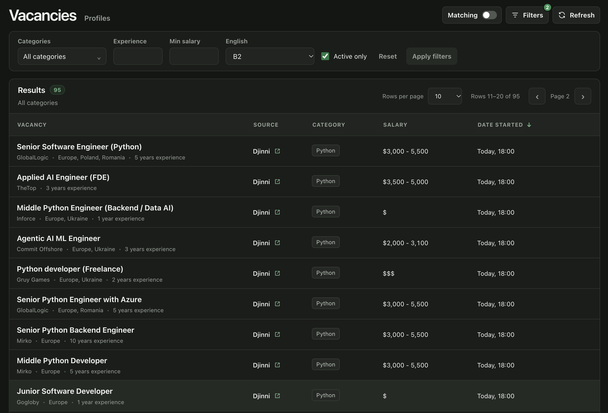
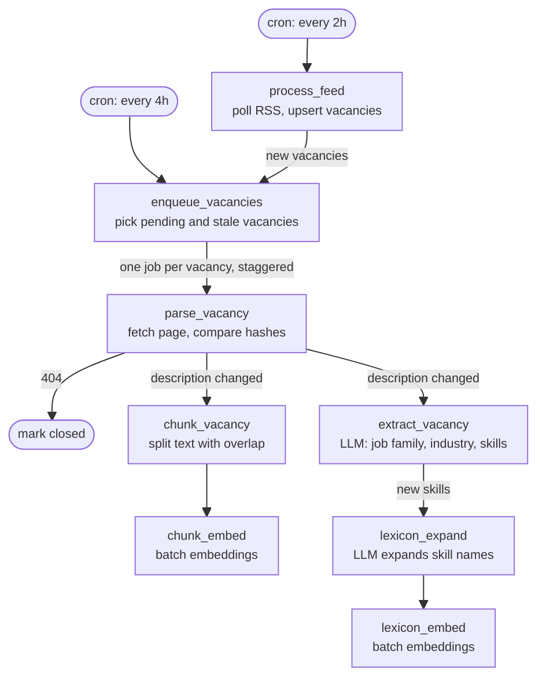
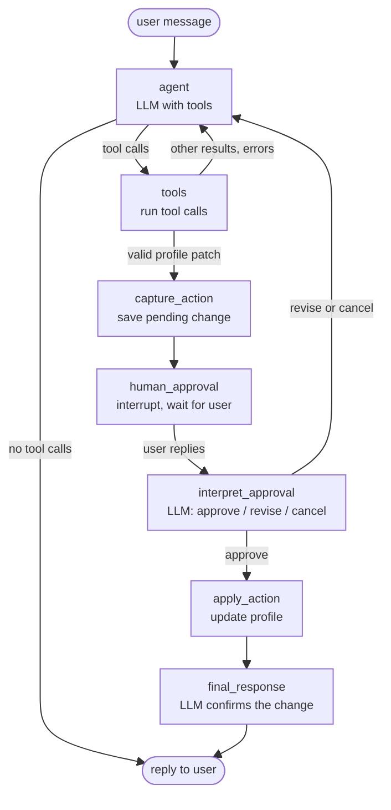

# Vacancy Desk

Vacancy Desk is a pet project that grew out of my own job search. Instead of scrolling job boards every day and reading the same kinds of postings over and over, I wanted something that keeps an eye on new vacancies for me, actually understands what they ask for, and tells me which ones are worth my time given my resume. 



## Highlights

- **Background ingestion pipeline**: new vacancies are collected from feeds on a schedule, and an LLM turns each free-text description into structured data (job family, industry, required skills with depth and importance) that profile scoring relies on. Vacancy texts are also split into chunks and embedded for semantic search. Built on [Procrastinate](https://procrastinate.readthedocs.io/), with cron jobs and queueing locks to avoid duplicate runs.
- **Hybrid search**: a BM25 keyword ranking over candidates that Postgres preselects by token overlap is merged with a semantic ranking by cosine similarity (`pgvector`) using Reciprocal Rank Fusion.
- **Search quality evals**: an offline script (`tests/evals`) runs hand-labeled queries and compares BM25, vector and RRF rankings by P@10, reciprocal rank, R@20 and nDCG@10, with runs traced in Langfuse. The labeled set is still small (2 queries), so the numbers are a sanity check, not a benchmark.
- **AI agent on LangGraph**: tool calling, Postgres checkpointer for chat state, and human-in-the-loop approval (`interrupt`) before the agent changes a profile.
- **Profiles**: a user uploads their resume (CV) text, the LLM extracts skills with depth, job families, experience, English level and seniority, and vacancies are scored against the resulting profile.

## Architecture

### Ingestion pipeline



### AI agent



Tools: `get_feature_instructions`, `list_profiles`, `get_profile`, `prepare_update_profile` and `search_vacancies` (hybrid search). The agent cannot change a profile directly: `prepare_update_profile` only proposes a patch, which is stored as a pending action. 

## Getting started

Requirements: Docker, an OpenAI API key, and a Langfuse project.

> [!IMPORTANT]
> The project does not start without its prompts in Langfuse. They are not stored in this repository: create `vacancy-extract`, `profile-extract`, `lexicon-expand`, `profiles-sys-prompt` and `vacancy-search-sys-prompt` in your Langfuse project and tag them with the label set in `PROMPT_LABEL`.

```bash
# 1. Copy the env template and replace the placeholders with real values
cp config/local.example.env config/local.env

# 2. Build the frontend (outputs to frontend/dist, mounted into the API container)
docker compose run --rm build-static

# 3. Start Postgres and apply migrations
docker compose up -d postgres
docker compose run --rm alembic upgrade head

# 4. Start the API and the background worker
docker compose up --build app worker
```

- App: http://localhost:8000/app
- API docs: http://localhost:8000/docs

Frontend dev server with hot reload (instead of step 2). Vite proxies `/api` to the `app` service, so that container has to be running:

```bash
docker compose up run-static   # http://localhost:5173/app/
```

## Tests & quality

```bash
docker compose run --rm pytest        # applies migrations to a test DB, then runs pytest
docker compose run --rm lint-mypy     # ruff format + ruff check + mypy (strict)
```
CI (GitHub Actions) runs lint, mypy and tests against a `pgvector` Postgres service on pushes to `main`, on pull requests, and on manual dispatch.

## Roadmap

Known limitations and what I plan to do about them:

- [ ] **Move BM25 into Postgres with `pg_search`.** Right now BM25 is scored in Python over candidates that Postgres preselects by token overlap, without a dedicated full-text index. This works on the current data volume but will not scale. Plan: index vacancies with `pg_search` and let Postgres return BM25 scores directly.
- [ ] **Grow the eval set.** The search evals run on only 2 hand-labeled queries, which is enough to catch regressions but not to compare ranking changes with confidence. Plan: label more queries with a bigger dataset.
- [ ] **UI for the AI chat.** The agent is only reachable through the REST API, so trying it out needs Swagger or curl. Plan: add a chat page to the React app, including a view of the proposed profile change for the approval step.
- [ ] **Configurable feeds.** The feed source and the polled category are hardcoded. Plan: move sources and categories into configuration, so the pipeline polls exactly the services and categories that are set up there.
